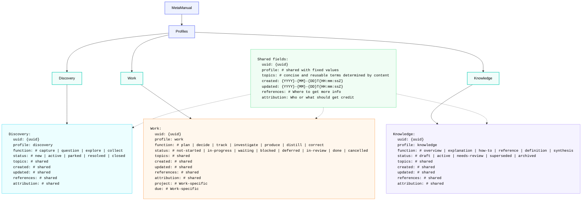

> [!INFO]
> A guide to help you determine the profile value, and therefore the entire set of metadata, to assign to any discovery, work, or knowledge artifact.

# MetaManual System Cheatsheet

MetaManual is a guide to helping anyone work with metadata and assign useful information to notes, documents, and research materials. This cheatsheet is a quick reference for all three Profiles — Discovery, Work, and Knowledge — with properties and values that accompany each. The goal is to help anyone, regardless of experience with metadata, YAML frontmatter, or knowledge management, assign meaningful attributes to make their working materials even more helpful.

## Profile Models

### Discovery

```yaml
id: {uuid}
profile: discovery
function: #  capture | question | explore | collect
status: #  new | active | parked | resolved | closed
topics: #  Enter one or more concise, reusable terms in kebab-case, such as metadata, color-theory, or content-modeling.
created: {YYYY-MM-DDTHH:mm:ss}
updated: {YYYY-MM-DDTHH:mm:ss}
references: #  Resources for additional information, evidence, or context. Format as list items.
attribution: #  People, organizations, or works whose ideas, information, or contributions should get credit. Format as list items.
```

### Work

```yaml
id: {uuid}
profile: work
function: #  plan | decide | track | investigate | produce | distill | correct
status: #  not-started | in-progress | waiting | blocked | deferred | in-review | done | canceled
topics: #  Enter one or more concise, reusable terms in kebab-case, such as metadata, color-theory, or content-modeling.
created: {YYYY-MM-DDTHH:mm:ss}
updated: {YYYY-MM-DDTHH:mm:ss}
references: #  Resources for additional information, evidence, or context. Format as list items.
attribution: #  People, organizations, or works whose ideas, information, or contributions should get credit. Format as list items.
project: #  Project artifact contributes to. Format: a single internal reference to the corresponding project artifact.
due: #  Target date by which the work should be completed. Format: {YYYY-MM-DD}
```

### Knowledge

```yaml
id: {uuid}
profile: discovery
function: #  overview | explanation | how-to | reference | definition | synthesis
status: #  draft | usable | needs-review | superseded | archived
topics: #  Enter one or more concise, reusable terms in kebab-case, such as metadata, color-theory, or content-modeling.
created: {YYYY-MM-DDTHH:mm:ss}
updated: {YYYY-MM-DDTHH:mm:ss}
references: #  Resources for additional information, evidence, or context. Format as list items.
attribution: #  People, organizations, or works whose ideas, information, or contributions should get credit. Format as list items.
```

## Visual Overview

